# AI 취업 비서 발표 자료

- [제출용 PDF](presentation.pdf)
- [편집용 PowerPoint](presentation.pptx)
- 작성일: 2026-10-29

현재 구현·기술 검증·사용자 피드백을 바탕으로 작성했다. 기술 테스트로 수정한 내용과 실제 사용자 피드백에 따른 기능 유지 결정을 구분한다. 실제 사용자 피드백은 2026-10-28 개발 직무 취업 준비생 5명이며, 전원 팀원이 아니고 익명 평가 활용에 동의했다는 프로젝트 담당자 확인에 따른다.

bb1885e의 일반 상담·검색 의도 보완, 서버 미동의 HTTP 403 3회, 담당자의 키 폐기·익명 처리 확인을 반영했다. 이전 시험과 최신 회귀 시험을 합산하지 않는다. [명세·검증 범위](../verification/final-evidence-scope.md)에 남은 시험을 정리했다.

아래는 PDF 각 페이지를 PNG로 내보낸 이미지다. GitHub에서 순서대로 확인할 수 있다. PPTX는 텍스트와 표를 편집할 수 있으며, 내용을 바꾸면 PDF와 이미지도 함께 다시 내보내 갱신해야 한다.

## 01. AI 취업 비서

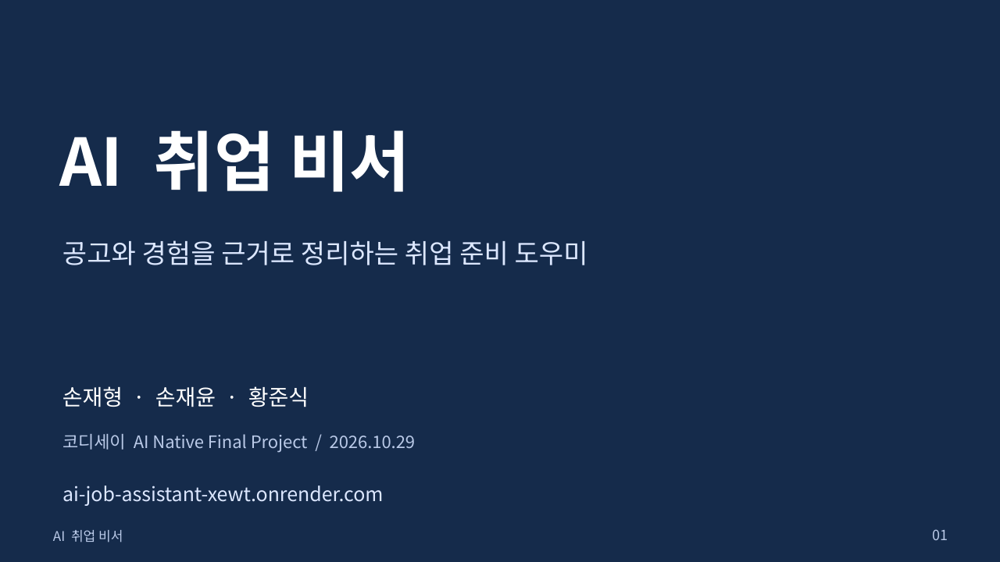

## 02. 문제와 대상 사용자

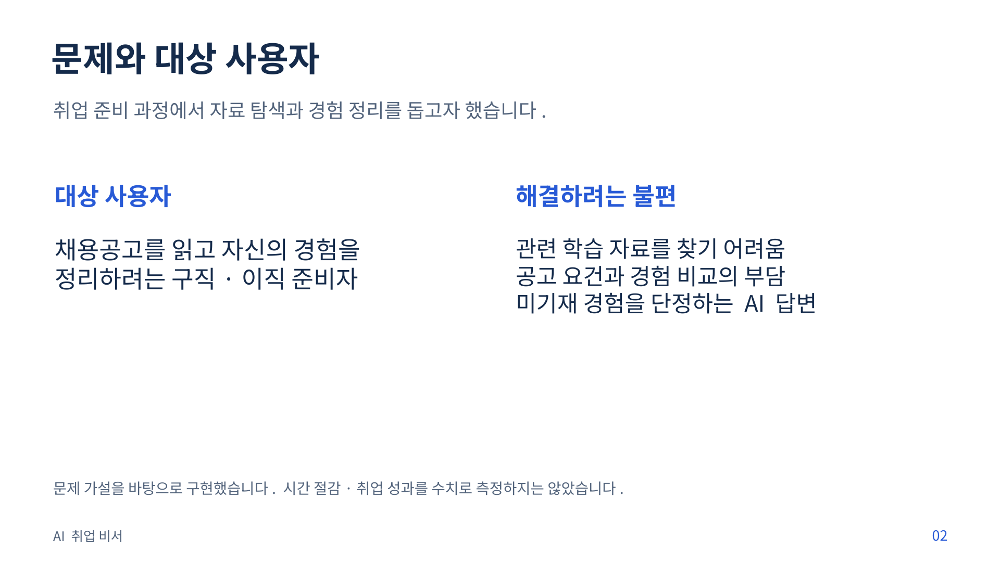

## 03. 서비스의 네 가지 기능

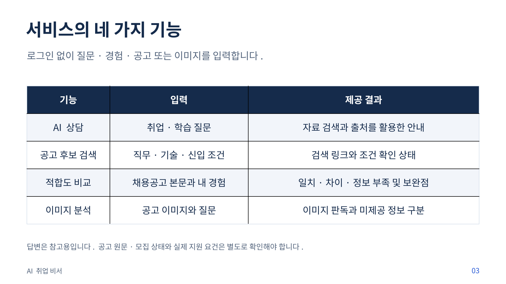

## 04. 시스템 구성과 기술 선택

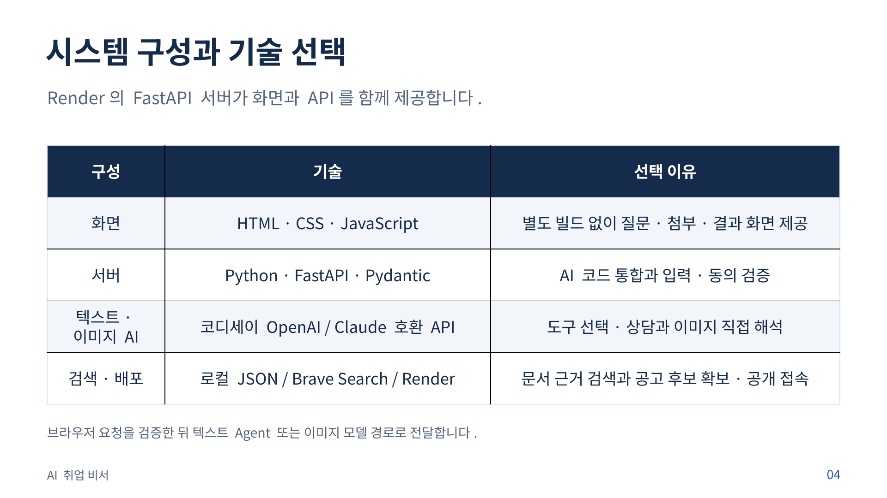

## 05. Agent의 도구 선택과 실행

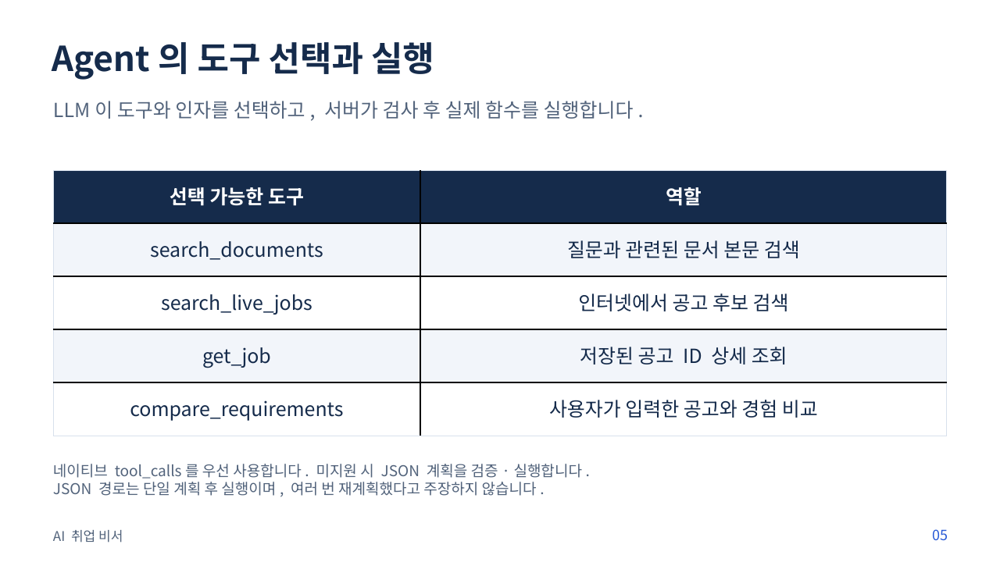

## 06. RAG의 질문별 문서 검색

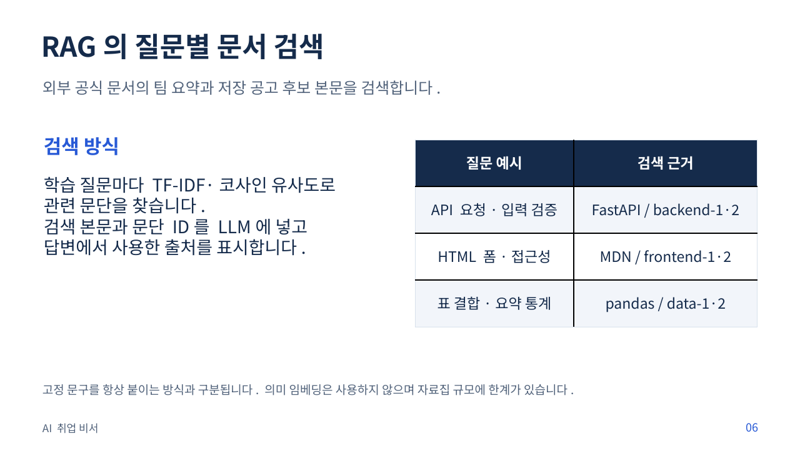

## 07. 기술 테스트에서 발견한 문제와 보완

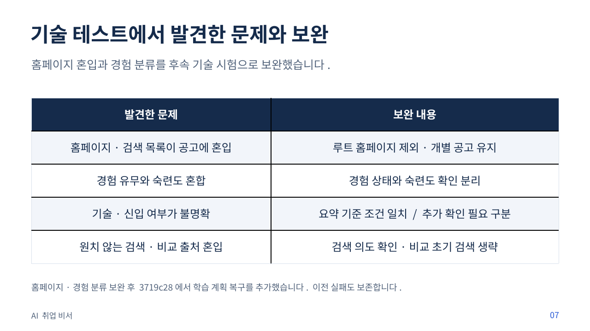

## 08. 기능 검증 결과와 범위

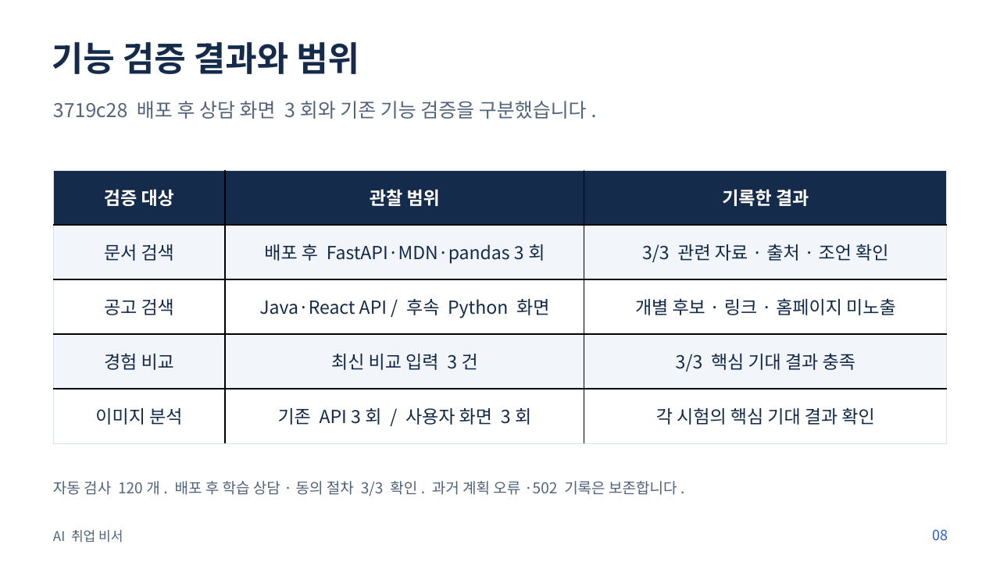

## 09. 이미지 입력의 실제 판독 사례

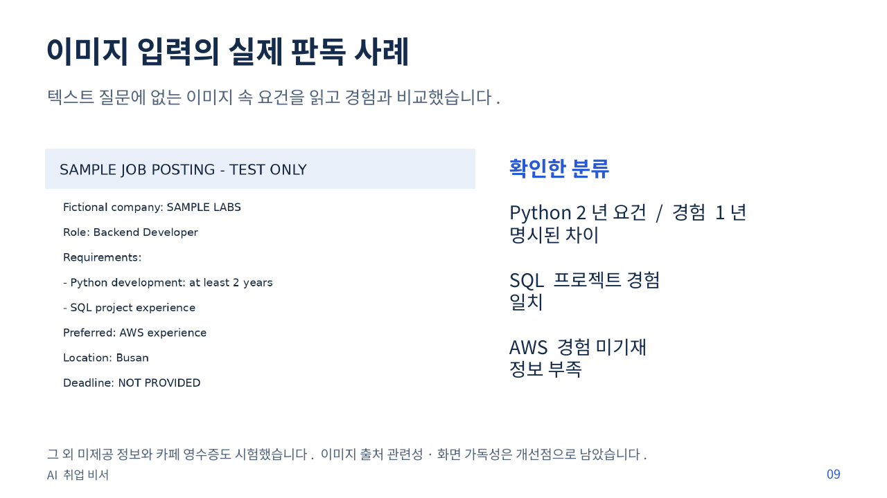

## 10. 실사용자 5명의 피드백

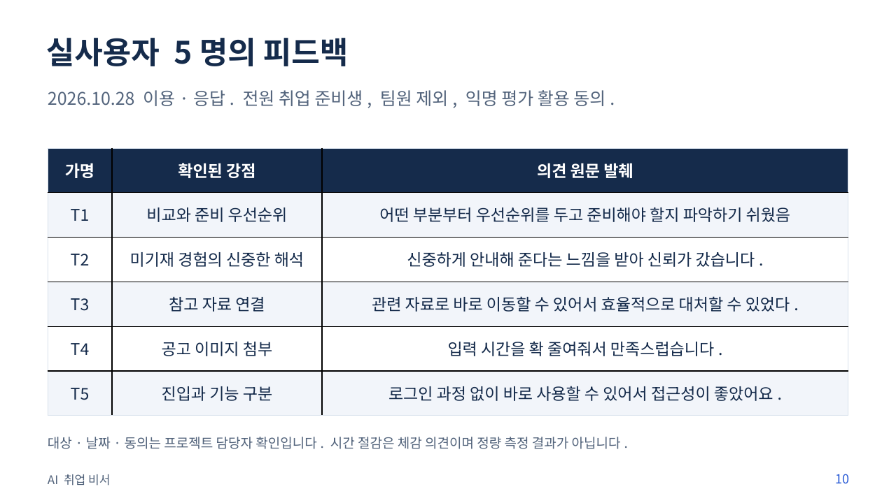

## 11. 피드백 이후의 검토 결과

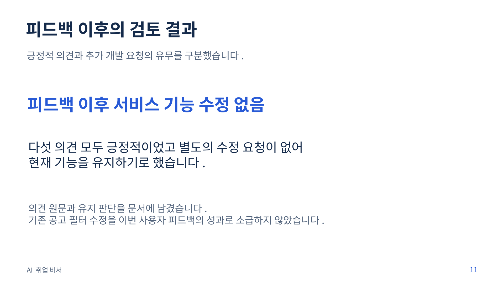

## 12. 역할 분담과 AI 윤리

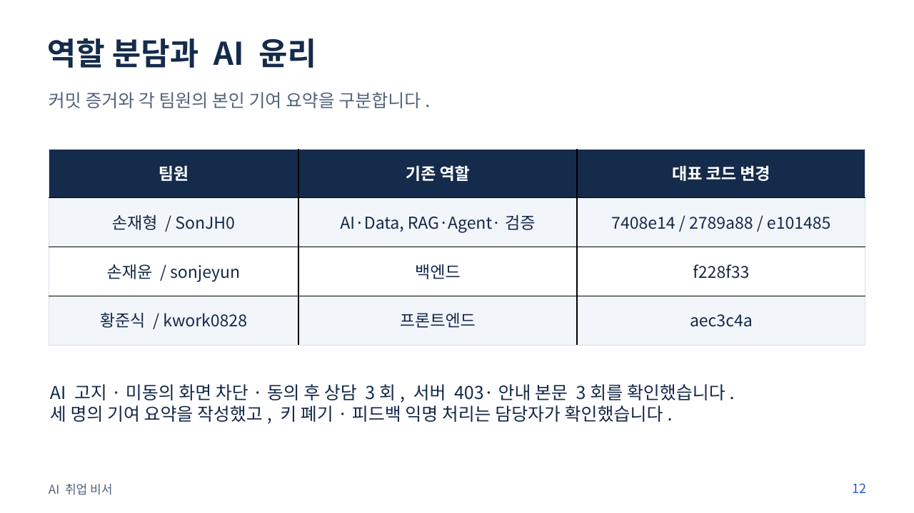

## 13. 현재 한계와 제출 자료

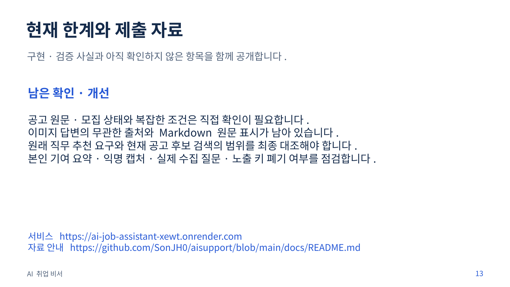

## 관련 자료

- [요구사항·기술별 코드 위치](../요구사항-정의서.md)
- [피드백 의견 이미지·검토 결과](../사용자-피드백-기록.md)
- [검증 기록](../verification/README.md)
- [팀원 본인 기여 요약](../팀원별-기여.md)

PPTX는 Noto Sans KR 글꼴을 사용한다. 편집 환경에 해당 글꼴이 없으면 대체 글꼴로 표시될 수 있다. 제출용 PDF와 PNG는 고정된 화면이다.

최신 반영: 4d0295b 코드 보완의 자동 검사 113개, 12:24~12:26 API 선택 재검증 6건. 비교 3/3·상담 1건·검색 2건으로 범위를 구분한다. 502는 이번에 재현되지 않았으나 원인은 미확정이다. [판정과 원문](../verification/latest-text-revalidation.md).

최종 추가: 3719c28 배포 후 FastAPI·MDN·pandas 상담 및 동의 화면 절차 각각 3/3 확인, 자동 검사 120개. [배포 후 검증 원문·한계](../verification/postdeploy-3719c28.md). 이전 6건은 당시 기록으로 구분한다.
