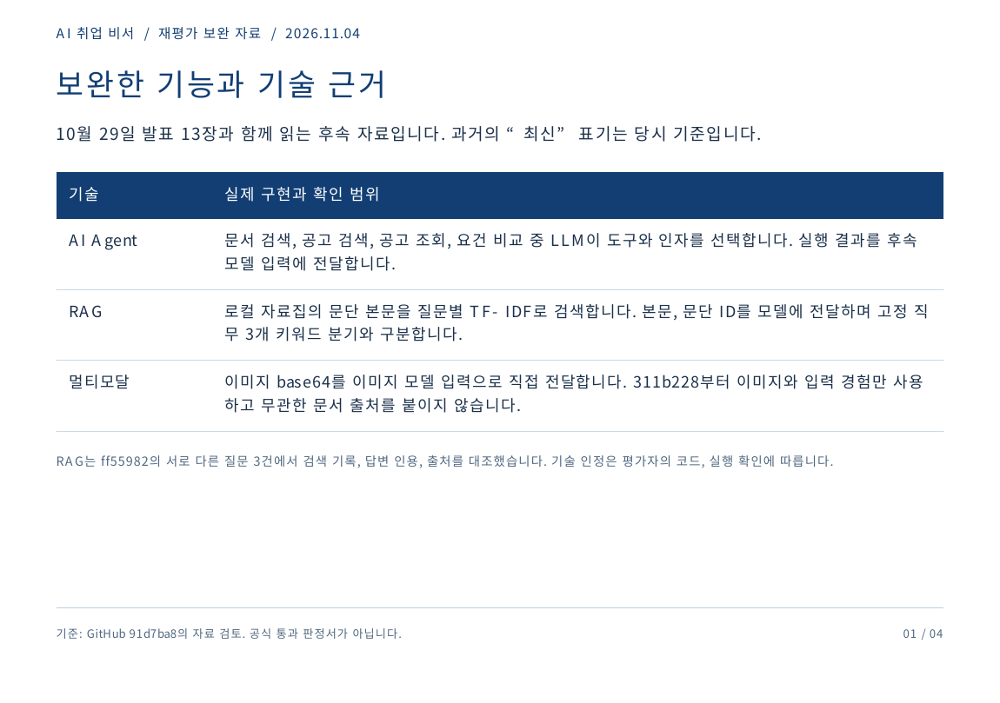
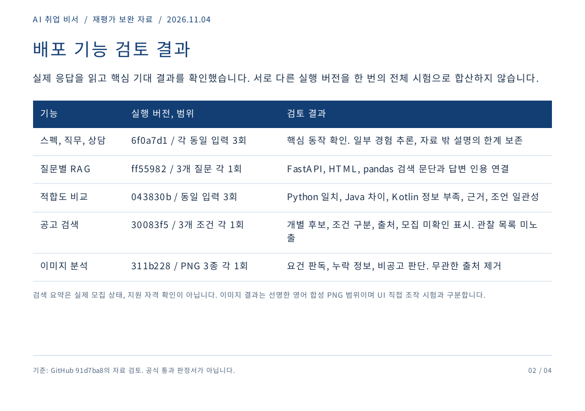
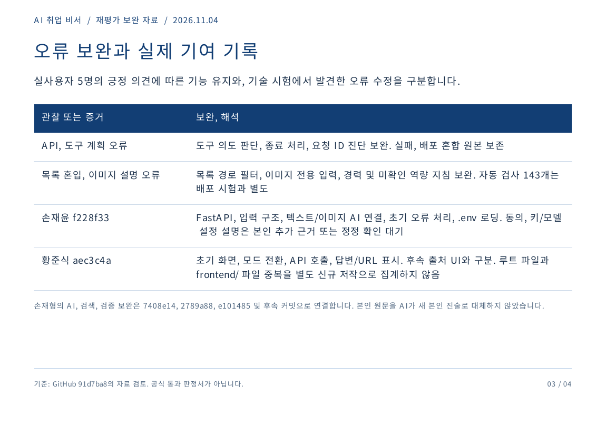
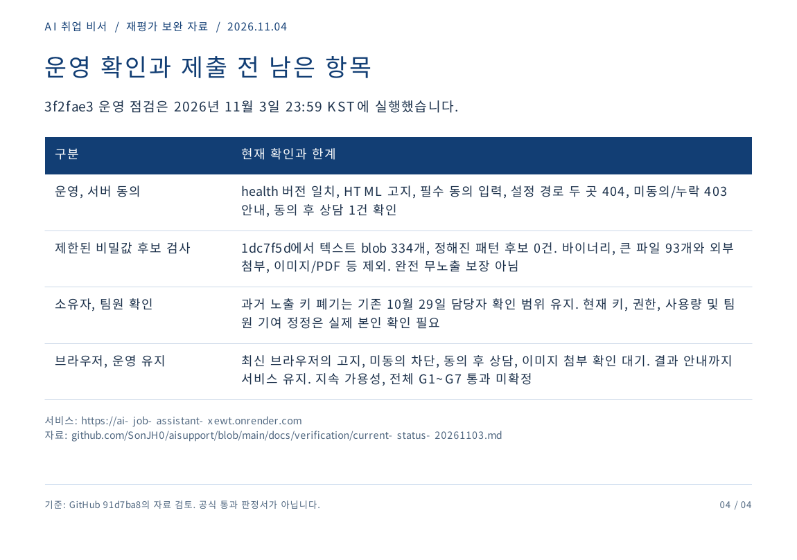

# 재평가 보완 발표 자료 — 2026-11-04

[보완 PDF 4쪽](reevaluation-update.pdf)을 10월 29일 기존 발표 13장과 함께 읽는다. 이번 자료는 기존 PowerPoint를 수정·재출력한 파일이 아니다. 기존 PPTX는 이전 13장의 편집 원본이며 이 보완 PDF의 편집 원본이 아니다.

현재 코드·검증과 기존 발표를 대조했다. 기존 발표 7~9·12~13쪽의 ‘최신’ 시험·자동 검사 수·이미지 출처 한계·기여 범위는 그 당시 기록이다. 이번 PDF는 후속 수정과 실제 결과·남은 확인을 보완한다. 공식 평가 화면 원본은 포함하지 않는다.

| 보완 쪽 | 내용 | 근거 |
|---|---|---|
| 1 | Agent·RAG·이미지 직접 입력 및 이미지 초기 검색 생략 | [명세](../../요구사항-정의서.md), [RAG 검토](../../verification/rag-evidence/20261103T141726405327Z/README.md) |
| 2 | 스펙·직무·상담·RAG·비교·검색·이미지의 실제 버전별 결과 | [공통 상태표](../../verification/current-status-20261103.md), [검색 30083f5](../../verification/search-image-evidence/20261103T144245951242Z/README.md), [이미지 311b228](../../verification/search-image-evidence/20261103T143605990242Z/README.md) |
| 3 | 오류 보완·기술 시험과 실사용자 의견 구분·팀원 기여 대조 | [기여 대조](../../verification/contribution-review-20261103/README.md), [실사용자 의견](../../사용자-피드백-기록.md) |
| 4 | 운영·비밀값 후보 검사 범위 및 실제 소유자·UI 확인 대기 | [운영 원본 검토](../../verification/final-operations-20261103/20261103T145931322287Z/README.md), [제한된 후보 검사](../../verification/final-operations-20261103/secret-scan.json) |

## 페이지 이미지

## 내용 확인 범위

네 페이지는 GitHub 91d7ba8까지의 실제 검토 자료를 바탕으로 작성했다. 다른 버전 결과를 동일 버전 전체 시험으로 합산하지 않았다. 실제 모집 상태·지원 자격·장기간 가용성·공식 G1~G7 통과를 확정하지 않는다. 팀원 본인 정정·키 소유자 확인·최신 브라우저 흐름은 남아 있다.

기존 발표의 실사용자 피드백과 문제 정의·기술 선택은 기본 설명으로 유지한다. 기존 PDF·PPTX·13장 PNG를 덮어쓰지 않았으므로, 평가자에게 이전 자료만 단독으로 제시하지 말고 보완 PDF도 함께 안내한다.
