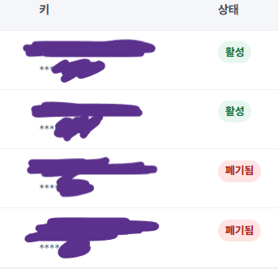

# 키 폐기 및 피드백 이미지 확인

확인일: 2026-10-29. 확인자: 프로젝트 담당자.

## 과거 노출 키

담당자는 키 관리 화면을 제공한 뒤, 과거 노출된 키가 ‘폐기됨’ 상태인 항목에 해당하는지 직접 비교·확인했다고 답했다. 화면에는 활성 2개와 폐기됨 2개가 보인다. 키 정보가 가려져 있어 AI가 과거 노출 값과 화면 항목을 독립적으로 대조한 것은 아니다. 화면의 상태 표시와 담당자의 해당 키 확인을 구분해 증거로 기록한다.

현재 활성 키를 폐기했다거나 모든 공급자 키를 일괄 점검했다고 확대하지 않는다. 키 값·부분 값·인증 헤더는 이 문서에 기록하지 않는다. 재발급과 별개로 과거 노출 키의 폐기 상태를 확인한 항목이다.

## 피드백 이미지

담당자는 공개한 T1~T5 피드백 이미지 5개에 식별정보가 없다고 확인했다. 이는 해당 이미지에 대한 담당자 확인이며 모든 저장소 파일·커밋 이력·외부 첨부·플랫폼 로그에 개인정보가 없다는 전수 검사 결과가 아니다.

## 남은 범위

- 저장소 전체 이력 및 그 밖의 제출물의 비밀값·개인정보 점검
- 외부 AI·검색·배포 서비스의 보관 정책 확인
- 최종 평가 전 서비스와 현재 사용 키의 정상 작동 유지

이 두 확인 사항만으로 G7 전체 또는 G1~G7 전체 통과를 확정하지 않는다. 키 값이나 식별정보가 포함된 원본을 추가로 제출할 필요는 없다.
