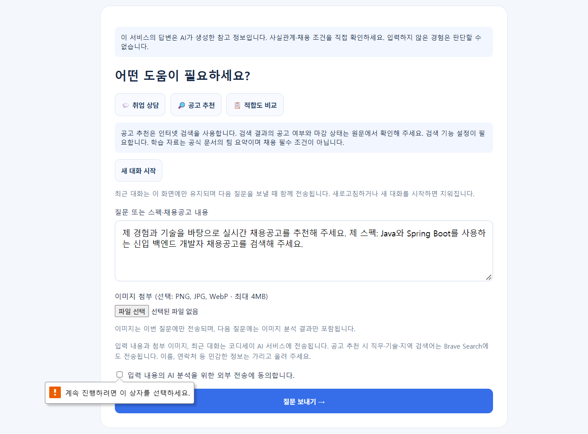
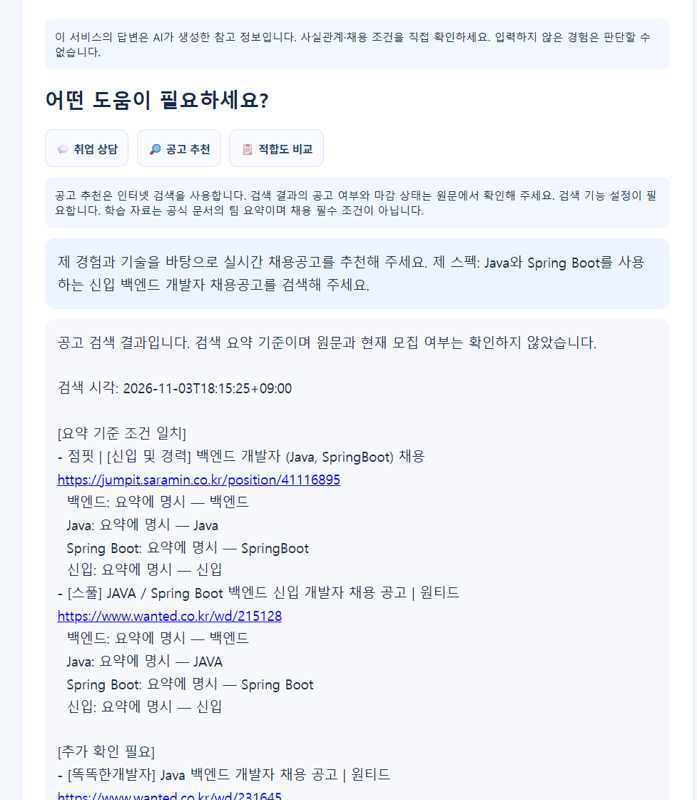
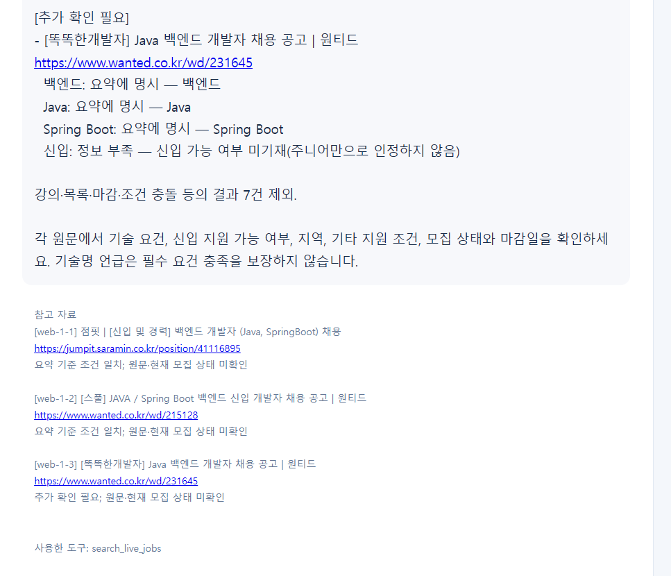

# 배포 화면 확인 — 2026-11-03

사용자가 제공한 서비스 화면 3장을 원본 그대로 보존한다. 공식 평가 화면이나 판정서는 포함하지 않는다. 아래는 화면에서 관찰한 범위의 자체 확인이다.

## 관찰 결과

| 항목 | 화면에서 확인한 내용 | 증거 및 한계 |
|---|---|---|
| AI 생성 고지 | 입력 전에 “이 서비스의 답변은 AI가 생성한 참고 정보입니다” 표시 | 화면 1. G7 고지 표시의 증거이며 G7 전체 충족 판정 아님 |
| 미동의 차단 | 외부 전송 동의가 미선택인 상태에서 “계속 진행하려면 이 상자를 선택하세요” 표시 | 화면 1. 브라우저 필수 입력 차단 확인. 서버의 직접 요청 차단·네트워크 미전송을 이 사진만으로 검증하지 않음 |
| 공고 검색 | Java·Spring Boot 신입 백엔드 요청에 검색 결과와 출처 표시 | 화면 2~3. 검색 시각 표시는 2026-11-03T18:15:25+09:00. 실제 검색 1회 관찰 |
| 조건 구분 | 요약 기준 조건 일치 2건, 추가 확인 필요 1건. 신입 미기재를 주니어만으로 인정하지 않음 | 화면 2~3. 요약에 기재된 조건과 원문·현재 모집 여부를 구분 |
| 도구 표시 | search_live_jobs 및 참고 자료 3개 표시 | 화면 3. UI에 표시된 도구이며 이 자료에는 서버 trace 원본이 없음 |

검색 결과에 점핏 41116895, 원티드 215128이 요약 기준 조건 일치로, 원티드 231645가 추가 확인 필요로 표시된다. 화면에는 강의·목록·마감·조건 충돌 등 7건 제외라고 표시되지만, 제외 원문 전체를 이 사진으로 재검증한 것은 아니다. 공고 원문과 현재 모집 상태는 별도로 확인해야 한다.

## 화면 증거

### 1. 입력 전 AI 고지와 미동의 차단

### 2. 검색 응답과 조건 일치 후보

### 3. 추가 확인 후보·출처·사용 도구

## 버전 및 범위

앞선 배포 확인에서 2444ebc6378c5085f5925bb87bd64e732f795b98이 확인되었지만, 이 화면에는 revision·요청 ID가 없다. 따라서 화면별 처리 인스턴스의 커밋을 직접 증명하는 자료로 사용하지 않는다.

이 결과는 공고 검색 3회 성공, 모든 Agent 분기 검증, 현재 채용 중인 공고 확인 또는 G1~G7 전체 통과를 의미하지 않는다. 실제 사용자 5명 피드백으로도 합산하지 않는다. 최신 선택 API 검토와 과거 실패 기록은 별도로 유지한다.

- [스펙·직무·상담 9건 검토 및 JSON](../review-6f0a7d1/README.md)
- [평가 지적별 보완 및 원래 기능 대응](../../재평가-보완.md)
- [실사용자 피드백 원문·시각](../../사용자-피드백-기록.md)
- [팀원 기여 자료](../../팀원별-기여.md)
- [키 폐기 확인 범위](../security-confirmation.md)
