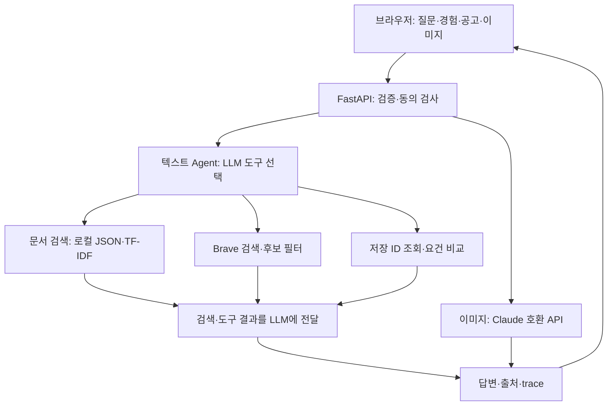

# 기능·비기능 요구사항 및 시스템 설계

갱신일: 2026-11-03. 소스 대조 기준: a0f11e0. 기능 범위와 우선순위는 유지했다. 기능 구현과 실제 배포 검증 결과를 구분한다.

> 현재 결과는 [구현·검증 상태표](verification/current-status-20261103.md)를 기준으로 읽는다. 상담·스펙·직무 및 비교의 검토된 결과가 있으나 공고·이미지의 최신 반복 시험 등은 남아 있다. 전체 통과 판정서는 아니다.

[최종 점검표](최종-점검표.md) · [평가 지적별 대응](재평가-보완.md). 초기 명세의 공고 추천과 평가 피드백의 직무 추천은 구분하며, 아래 기능을 빼거나 이름만 바꿔 지적을 해소했다고 주장하지 않는다.

## 1. 기능 요구사항

| ID | 기능 | 우선순위 | 설명 | 코드 |
|---|---|---|---|---|
| FR-01 | AI 상담 | Must | 질문별 문서 본문 검색 결과를 활용해 학습 조언·추가 질문과 근거 제공 | ai/agent.py, ai/retrieval.py |
| FR-02 | 공고 후보 추천 | Must | 인터넷 검색 후보를 필터링하고 요약 조건 확인 상태·링크·모집 미확인 표시 | ai/agent.py, ai/web_search.py |
| FR-03 | 적합도 비교 | Must | 입력 공고·경험의 요건별 근거와 일치·차이·정보 부족, 확인 질문·보완 행동 제공 | ai/comparison.py, ai/agent.py |
| FR-04 | 이미지 분석 | Must | 이미지 자체를 모델에 전달해 보이는 내용과 미제공 정보를 구분 | ai/vision.py, backend/main.py |
| FR-05 | 전송 동의·AI 안내 | Must | AI 생성 정보와 외부 전송을 알리고 미동의 요청 차단 | frontend/index.html, backend/main.py |

FR-01~04는 기존 Must 범위를 유지한다. FR-05은 윤리·개인정보 요구를 명시한 항목이다. 실제 모집 중인 공고만 추천하거나 적합도 점수를 계산하는 기능은 구현하지 않았다.

## 2. 비기능 요구사항과 구현 한계

| ID | 항목 | 확인 가능한 동작 또는 목표 | 현재 상태 |
|---|---|---|---|
| NFR-01 | 입력 검증 | 텍스트 최대 10,000자, history 최대 10개, 공백 질문 거절 | 서버 모델·자동 검사 있음 |
| NFR-02 | 이미지 입력 | PNG/JPEG/WebP, 디코딩 후 4MB 이하, 잘못된 형식 거절 | 코드·잘못된 입력 자동 검사, 실제 선명한 PNG 3종 확인 |
| NFR-03 | 대기·오류 | 화면 대기 제한 210초, 실패 시 안내. 텍스트 API timeout 45초·이미지 90초 | 설정 구현. 모델·검색 여러 단계가 있어 응답 5초 보장을 하지 않음 |
| NFR-04 | 서비스 접근 | 공개 URL에서 로그인 없이 사용 가능, /health 상태 응답 | 접속 관찰 있음. 일정 비율의 가동률을 측정하거나 보장하지 않음 |
| NFR-05 | 개인정보 | 외부 전송 전 동의, 피드백 가명화, 실제 키 미커밋 | 화면·서버 동의 확인. 2026-10-29 담당자가 과거 노출 키 폐기·공개 피드백 이미지 식별정보 없음을 확인. 외부 보관·저장소 전체 이력은 별도 |
| NFR-06 | 출처·신뢰성 | 미기재 경험을 미보유로 단정하지 않고 공고 상태 미확인 명시 | 시험 사례에서 확인. 모든 입력·조건의 정확성은 미보장 |
| NFR-07 | 유지보수 | 소스·문서·테스트 Git 관리 | 6f0a7d1 보완 당시 자동 검사 135개 기록. 이번 문서 작업에서 재실행하지 않음. 실환경 시험과 별도 |

## 3. 아키텍처

서버는 Render에서 화면 정적 파일과 `/api/chat`을 함께 제공한다. 초기 문서 검색은 학습 상담 등 텍스트·이미지 경로에서 수행하며, 사용자가 공고·경험을 제공한 비교에서는 생략한다. 위 그림은 개념 흐름이며 비교·검색 단독 답변은 실제 도구 결과로 최종 표시를 구성한다. 이미지 경로에는 별도 초기 문서 검색 근거도 전달된다. 공고 검색 단독 답변은 최종 표시를 필터 결과 필드로 구성하여 모델의 확정 추천으로 바뀌지 않게 한다. 복합 도구 요청에서는 이 보장이 동일하게 적용되지 않는 한계가 있다.

API 입력: `message`, `history`, 선택적 `image` data URL, `consent`. 기본 응답: `answer`, `tools`, `sources`, `trace`, `ai_generated`. 이미지 경로는 `image_analyzed`를 추가한다. 이미지 경로의 tools가 빈 배열이어도 이미지 처리 실패라는 뜻은 아니다. 이미지 모델 응답과 image_analysis trace로 확인한다.

## 4. AI 활용 명세

| 기술 | 동작 | 코드 위치 | 실제 확인 근거 |
|---|---|---|---|
| Agent | LLM이 search_documents/search_live_jobs/get_job/compare_requirements 중 선택하고 인자를 정함. 검증 후 실제 결과를 모델에 전달 | ai/agent.py: TOOLS, respond, _json_agent, run_tool | 배포 요청별 서로 다른 도구 실행·trace와 실제 API 검사. 네이티브는 반복 실행, JSON은 단일 계획 후 실행 |
| RAG | 학습 질문별 문서 본문 검색 후 결과를 프롬프트에 넣음. 입력 공고 비교의 초기 검색은 생략 | ai/retrieval.py: search_documents/rank_documents, ai/agent.py: respond, data/knowledge.json | 백엔드·프론트엔드·pandas 질문에 다른 문단 ID 및 출처 반환 |
| 멀티모달 | 이미지 base64를 모델의 image 블록으로 전달 | ai/vision.py: analyze_image | 이미지에만 적힌 회사·직무·요건 판독, 미제공·비공고 구분. API 3회·화면 3회 별도 관찰 |

실시간 검색 도구 호출 자체만을 RAG의 유일한 근거로 삼지 않는다. 로컬 외부 지식 본문 검색과 LLM 입력 연결로 설명한다. TF-IDF는 의미 임베딩이 아니며 작은 자료집에 한계가 있다. Long-term Memory와 자동화 워크플로우는 구현 기술로 포함하지 않는다. 최종 기술 인정은 평가자의 코드·실행 확인에 따른다.

## 5. 구현 현황 및 평가 확인 방법

[현재 Must별 입력·절차·기대 결과·버전·회차·미확인 범위](verification/current-status-20261103.md#현재-must와-검증-결과)를 공통 상태표로 사용한다. 원래 평가 기능명 대응도 같은 문서에 기록한다.

과거 시점의 세부 표와 누적 기록은 [정리 전 명세 원본](archive/status-before-20261103/요구사항-정의서.md)에 보존했다. 이 보관본의 상대 링크는 당시 경로 기준이며 현재 자료 탐색은 위 상태표를 사용한다. 과거 문서의 “최신”, “검증 전”은 당시 상태를 뜻한다.
