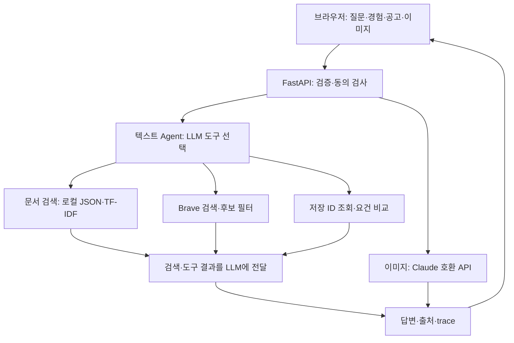

# 기능·비기능 요구사항 및 시스템 설계

갱신일: 2026-10-29. 구현 기준: 4d0295b. 기존 e101485·bb1885e와 후속 보완 기록을 보존한다. 검증 시점·버전은 개별 기록에서 구분한다. 이 문서는 현재 기능의 평가용 확인 절차를 정리한다. 과거 초안과 테스트 원본은 보존한다. [보관한 초기 명세](archive/기획-및-요구사항.md)의 Must는 AI 상담·공고 추천·적합도 비교·이미지 분석이다. 공고 추천은 검색한 공고와 출처 또는 없음 안내를 요구하며, 별도 직무 목록 생성은 명시하지 않는다. [대조 및 검증 범위](verification/final-evidence-scope.md)를 참고한다.

## 1. 기능 요구사항

| ID | 기능 | 우선순위 | 설명 | 코드 |
|---|---|---|---|---|
| FR-01 | AI 상담 | Must | 질문별 문서 본문 검색 결과를 활용해 학습 조언·추가 질문과 근거 제공 | ai/agent.py, ai/retrieval.py |
| FR-02 | 공고 후보 추천 | Must | 인터넷 검색 후보를 필터링하고 요약 조건 확인 상태·링크·모집 미확인 표시 | ai/agent.py, ai/web_search.py |
| FR-03 | 적합도 비교 | Must | 입력 공고·경험의 요건별 근거와 일치·차이·정보 부족, 확인 질문·보완 행동 제공 | ai/comparison.py, ai/agent.py |
| FR-04 | 이미지 분석 | Must | 이미지 자체를 모델에 전달해 보이는 내용과 미제공 정보를 구분 | ai/vision.py, backend/main.py |
| FR-05 | 최근 대화 | Should | 현재 화면의 최근 10개 메시지를 후속 질문에 전달 | frontend/app.js |
| FR-06 | 전송 동의·AI 안내 | Must | AI 생성 정보와 외부 전송을 알리고 미동의 요청 차단 | frontend/index.html, backend/main.py |

FR-01~04는 기존 Must 범위를 유지한다. FR-06은 윤리·개인정보 요구를 명시한 항목이다. FR-05는 세션 내 대화일 뿐 장기 메모리가 아니다. 실제 모집 중인 공고만 추천하거나 적합도 점수를 계산하는 기능은 구현하지 않았다.

## 2. 비기능 요구사항과 구현 한계

| ID | 항목 | 확인 가능한 동작 또는 목표 | 현재 상태 |
|---|---|---|---|
| NFR-01 | 입력 검증 | 텍스트 최대 10,000자, history 최대 10개, 공백 질문 거절 | 서버 모델·자동 검사 있음 |
| NFR-02 | 이미지 입력 | PNG/JPEG/WebP, 디코딩 후 4MB 이하, 잘못된 형식 거절 | 코드·잘못된 입력 자동 검사, 실제 선명한 PNG 3종 확인 |
| NFR-03 | 대기·오류 | 화면 대기 제한 210초, 실패 시 안내. 텍스트 API timeout 45초·이미지 90초 | 설정 구현. 모델·검색 여러 단계가 있어 응답 5초 보장을 하지 않음 |
| NFR-04 | 서비스 접근 | 공개 URL에서 로그인 없이 사용 가능, /health 상태 응답 | 접속 관찰 있음. 일정 비율의 가동률을 측정하거나 보장하지 않음 |
| NFR-05 | 개인정보 | 외부 전송 전 동의, 피드백 가명화, 실제 키 미커밋 | 화면·서버 동의 확인. 2026-10-29 담당자가 과거 노출 키 폐기·공개 피드백 이미지 식별정보 없음을 확인. 외부 보관·저장소 전체 이력은 별도 |
| NFR-06 | 출처·신뢰성 | 미기재 경험을 미보유로 단정하지 않고 공고 상태 미확인 명시 | 시험 사례에서 확인. 모든 입력·조건의 정확성은 미보장 |
| NFR-07 | 유지보수 | 소스·문서·테스트 Git 관리 | 기존 74개·97개 및 최신 보완 113개 자동 검사 기록. 실제 사용자 기능 검사와 별도 |

## 3. 아키텍처

서버는 Render에서 화면 정적 파일과 `/api/chat`을 함께 제공한다. 초기 문서 검색은 텍스트·이미지 경로에서 수행한다. 위 그림의 이미지 경로에는 별도 초기 문서 검색 근거도 전달된다. 공고 검색 단독 답변은 최종 표시를 필터 결과 필드로 구성하여 모델의 확정 추천으로 바뀌지 않게 한다. 복합 도구 요청에서는 이 보장이 동일하게 적용되지 않는 한계가 있다.

API 입력: `message`, `history`, 선택적 `image` data URL, `consent`. 기본 응답: `answer`, `tools`, `sources`, `trace`, `ai_generated`. 이미지 경로는 `image_analyzed`를 추가한다. 이미지 경로의 tools가 빈 배열이어도 이미지 처리 실패라는 뜻은 아니다. 이미지 모델 응답과 image_analysis trace로 확인한다.

## 4. AI 활용 명세

| 기술 | 동작 | 코드 위치 | 실제 확인 근거 |
|---|---|---|---|
| Agent | LLM이 search_documents/search_live_jobs/get_job/compare_requirements 중 선택하고 인자를 정함. 검증 후 실제 결과를 모델에 전달 | ai/agent.py: TOOLS, respond, _json_agent, run_tool | 배포 요청별 서로 다른 도구 실행·trace와 실제 API 검사. 네이티브는 반복 실행, JSON은 단일 계획 후 실행 |
| RAG | 매 질문 문서 본문 검색 후 결과를 프롬프트에 넣음 | ai/retrieval.py: search_documents/rank_documents, ai/agent.py: respond, data/knowledge.json | 백엔드·프론트엔드·pandas 질문에 다른 문단 ID 및 출처 반환 |
| 멀티모달 | 이미지 base64를 모델의 image 블록으로 전달 | ai/vision.py: analyze_image | 이미지에만 적힌 회사·직무·요건 판독, 미제공·비공고 구분. API 3회·화면 3회 별도 관찰 |

실시간 검색 도구 호출 자체만을 RAG의 유일한 근거로 삼지 않는다. 로컬 외부 지식 본문 검색과 LLM 입력 연결로 설명한다. TF-IDF는 의미 임베딩이 아니며 작은 자료집에 한계가 있다. Long-term Memory와 자동화 워크플로우는 구현 기술로 포함하지 않는다. 최종 기술 인정은 평가자의 코드·실행 확인에 따른다.

## 5. 구현 현황 및 평가 확인 방법

공통 절차: 배포 URL 접속 → 새 대화 시작 → 아래 입력 → 외부 전송 동의 → 전송. 각 행의 기능마다 3회 시도 결과를 기록하고 2회 이상 기대 결과가 나오면 해당 시험 범위에서 충족으로 판단한다. 서로 다른 커밋·모델·기능 범위의 결과를 섞어 최신 버전 3회 성공으로 쓰지 않는다.

| 기능 / Must | 구현 여부 | 화면·입력·확인 방법 | 기대 결과 | 현재 검증 근거와 한계 |
|---|---|---|---|---|
| AI 상담 / Must | 구현 | 취업 상담에서 `백엔드 API 요청 본문과 입력 검증을 배우려면 어떤 자료를 참고하나요?` 전송. 별도 새 대화에서 HTML 폼·접근성, pandas 표 결합·통계 질문 | 질문별 FastAPI/MDN/pandas 문단과 출처·조언 | 수정 전 화면 3/3과 bb1885e 일반 상담 2건을 보존. 12:24 최신 선택 실행은 FastAPI 1건 핵심 기대 결과 충족. 이전 MDN·pandas와 합쳐 최신판 새 3회로 표시하지 않음 |
| 공고 후보 추천 / Must | 구현 | 공고 추천에서 Python·FastAPI 신입 백엔드, Java·Spring Boot 신입 백엔드, React·TypeScript 신입 프론트엔드를 각각 검색 | 개별 공고 후보·원문 링크·조건 확인 구분·모집 상태 미확인. 없으면 없음 안내. 강의·검색 목록 제외 | 이전 실패 보존. 4d0295b 보완 뒤 12:25 Java 4개·React 3개 개별 후보와 홈페이지 미노출 확인(선택 실행 2/2). 이전 Python 검색과 합쳐 최신판 새 3회로 표시하지 않음 |
| 적합도 비교 / Must | 구현 | 적합도 비교에서 경험 `Python으로 REST API를 만들었습니다. Java로 게시판 프로젝트를 만들었습니다. Kotlin은 사용해 본 적이 없습니다.` / 공고 `Python API 개발 경험 / Java 개발 경험 / Kotlin 개발 경험` 입력 | Python·Java 일치, Kotlin 차이, 입력 근거·확인 질문·보완 행동 | 12:26 비교 3건 모두 핵심 기대 결과 충족(3/3). Python 경험 일치와 숙련도 미확인 분리, 미기재 SQL 정보 부족, 무관한 초기 출처 미노출 확인. 일반 공고의 복합 문장·제목 파싱은 별도 한계 |
| 이미지 분석 / Must | 구현 | 취업 상담의 이미지 첨부에서 docs/image-validation의 PNG 3개를 하나씩 첨부하고 image-validation.md의 회차별 질문 입력 | 공고 요건 판독·비교, 미제공 항목 미확인, 영수증 비공고 판단 | API 직접 요청 3회와 사용자 제공 화면 3회에서 핵심 기대 결과 확인. 출처 관련성·표시 가독성은 미해결 |
| 동의·AI 안내 / Must | 구현 | 페이지 하단 AI 안내 확인. 동의 없이 전송 시도 후 동의하고 전송. 서버 직접 요청도 consent=false로 확인 가능 | 미동의 시 화면 진행 차단·서버 403, 동의 후 처리 | AI 고지·브라우저 차단 2회·동의 후 응답 확인. bb1885e 배포 뒤 consent=false 요청 3회 모두 HTTP 403. 응답 본문 미확인, 통합 절차 3회 미완료. 공개 피드백 이미지 5개에 식별정보 없음은 2026-10-29 담당자 확인 |

상세 날짜·질문·응답·버전·성공/부분 성공 근거는 연결된 검증 원문과 진행 기록을 참고한다. [사용자 제공 화면·서버 결과](verification/final-ui-20261029.md)에서 새 결과와 원본 캡처를 확인한다. 최신 배포본의 기능별 결과와 미확인 범위는 [최종 점검표](최종-점검표.md)에서 기록한다. 이미지 판독 성공은 실제 회사 요건의 최신성·지원 적합성 검증이 아니다.

최신 6건의 입력·응답·개별 판정과 배포 SHA 관찰 한계는 [텍스트 재검증](verification/latest-text-revalidation.md)에 기록한다.
